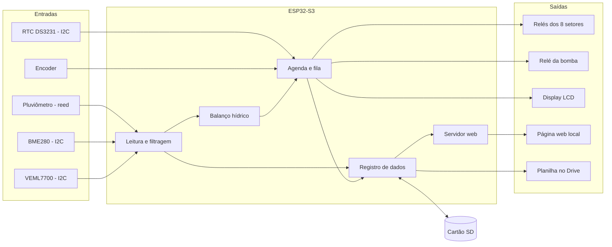
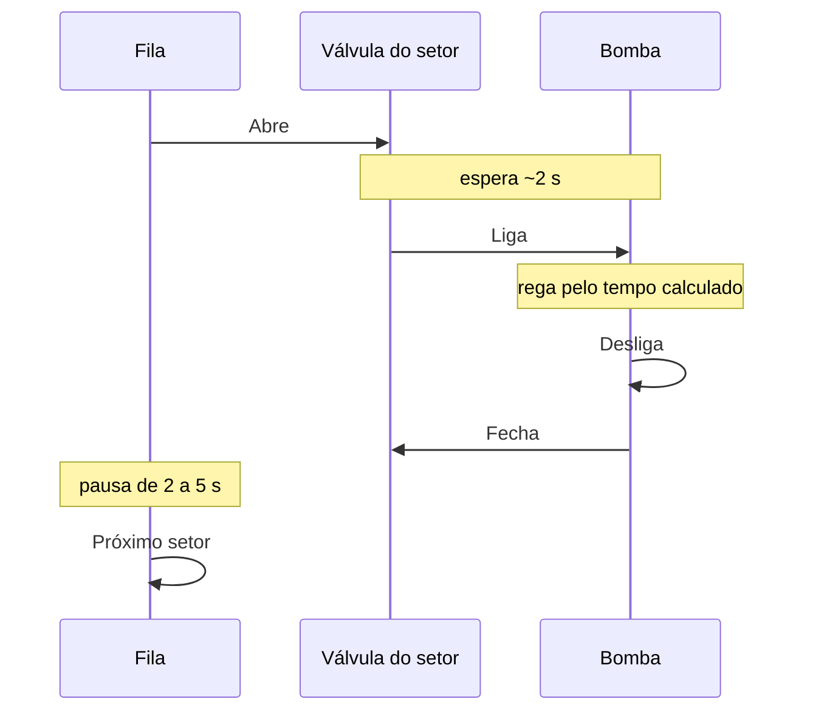

# Arquitetura

## Visão do sistema



## Módulos de software

- **Leitura de sensores:** contagem de pulsos do pluviômetro por interrupção e leitura periódica do I2C.
- **Balanço hídrico:** calcula a evapotranspiração, o saldo de água e o tempo de rega de cada setor.
- **Agendador e fila:** máquina de estados que mantém um único setor ligado por vez.
- **Registro:** grava chuva, clima e eventos de rega.
- **Interface:** display com encoder e servidor web.
- **Segurança:** saídas desligadas no boot, watchdog e limites de tempo e de horário.

## Princípios

1. O controle nunca depende da rede.
2. Só um relé de setor acionado por vez.
3. Na dúvida, desligado. No boot, o nível de desligado é escrito em cada pino antes de ele virar saída (a placa de relés costuma ser ativa em nível baixo). Depois de uma queda de energia, nenhuma rega é retomada. Se o firmware travar, o watchdog reinicia o ESP com tudo desligado.

## Lógica de irrigação

O controlador mantém um saldo de água por setor, como uma conta bancária: a chuva e a rega entram, e a evapotranspiração sai.

```
ET0   = 0,0023 x (Tmédia + 17,8) x raiz(Tmáx - Tmín) x Ra     (Hargreaves)
ETc   = ET0 x Kc
Saldo = saldo anterior + chuva efetiva + rega - ETc
Tempo de rega = déficit / (taxa de aplicação x eficiência)
```

- Ra é a radiação no topo da atmosfera, calculada pela latitude e pelo dia do ano. A latitude entra na configuração inicial.
- A chuva efetiva desconta chuvas muito fracas, e o saldo é limitado pela capacidade do solo.
- Parâmetros de cada setor: tipo, Kc (começa em 1,0 para o cacau adulto), taxa de aplicação em mm/h (medida), eficiência, déficit mínimo para disparar, tempo máximo, janela de horário e fator de ajuste.
- Gotejo pede regas curtas e frequentes. Aspersão fica na madrugada ou no início da manhã, para a folhagem secar.
- É uma estimativa: os parâmetros são calibrados observando o solo. A taxa de aplicação de cada setor é medida (método dos copos na aspersão, vazão dos gotejadores no gotejo), porque um erro nela vira erro direto no tempo de rega.

### Sensores que entram na decisão

| Medida | Uso na versão 1 |
| --- | --- |
| Chuva | Entra no saldo (chuva efetiva) |
| Temperatura máxima e mínima | Entra na ET0 (Hargreaves) |
| Umidade, pressão e luz | Registro e histórico |

O Hargreaves foi escolhido porque só precisa de temperatura, que é a medida mais confiável da estação. Umidade, pressão e luz ficam guardadas desde o começo, para que uma versão futura possa usar uma fórmula mais completa (como a Penman-Monteith, que pede também vento) e ser comparada com o histórico. Para a luz entrar na conta, o VEML7700 precisa ser calibrado em W/m² contra uma referência, porque lux atrás de acrílico leitoso não é radiação solar.

### Sequência de uma rega

1. A válvula do setor abre.
2. Depois de cerca de 2 s, a bomba liga.
3. No fim, a bomba desliga e só então a válvula fecha.
4. Uma pausa de 2 a 5 s separa um setor do próximo, e o setor seguinte vem da fila.



## Interface

**Local:** display 128x64 com encoder. Girar navega ou altera valores, o clique curto seleciona e o clique longo volta.

**Web (celular e computador)**

- Painel: chuva do dia e do mês, temperatura e luz, destaque do setor regando com tempo restante, botões de pular e parar, lista de setores e fila.
- Histórico: chuva por hora e por dia, temperatura máxima e download em CSV.
- Ajustes: modo ciclo ou individual, horários e parâmetros de cada setor, com aviso de conflito entre horários.
- Acesso: o Wi-Fi próprio (AP) tem senha, e ligar, parar ou alterar ajustes pede autenticação. Só consultar o painel pode ficar livre.

## Dados e registro

- **Chuva:** intervalos de 10 minutos gravados só enquanto chove, somados por hora, dia e mês (cerca de 210 KB por ano no pior caso).
- **Clima:** uma leitura por hora na flash (cerca de 140 KB por ano).
- **Configuração e contadores:** na NVS (Preferences), gravados em intervalos e não a cada evento, para poupar a flash.
- **Cartão SD:** um arquivo CSV por dia, mantido por 7 dias.
- **Drive:** envio periódico para uma planilha por semana, em conta própria do projeto, via Google Apps Script. O arquivo só é apagado do cartão depois da confirmação do envio.
