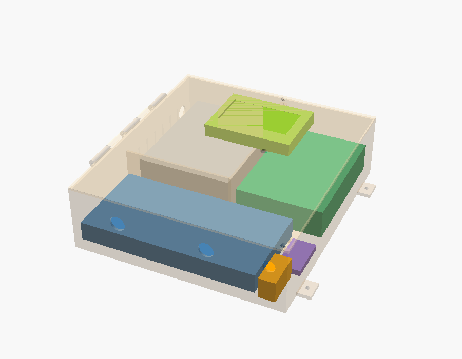
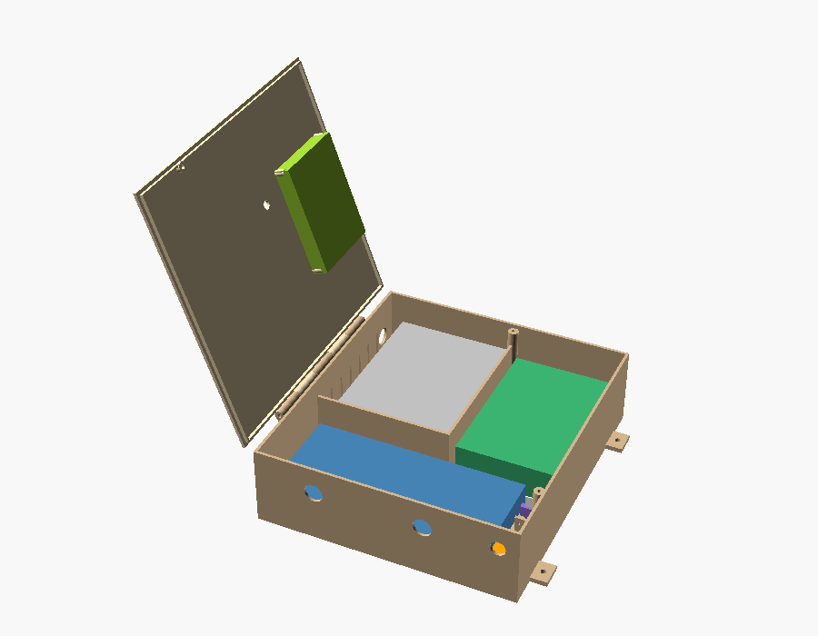
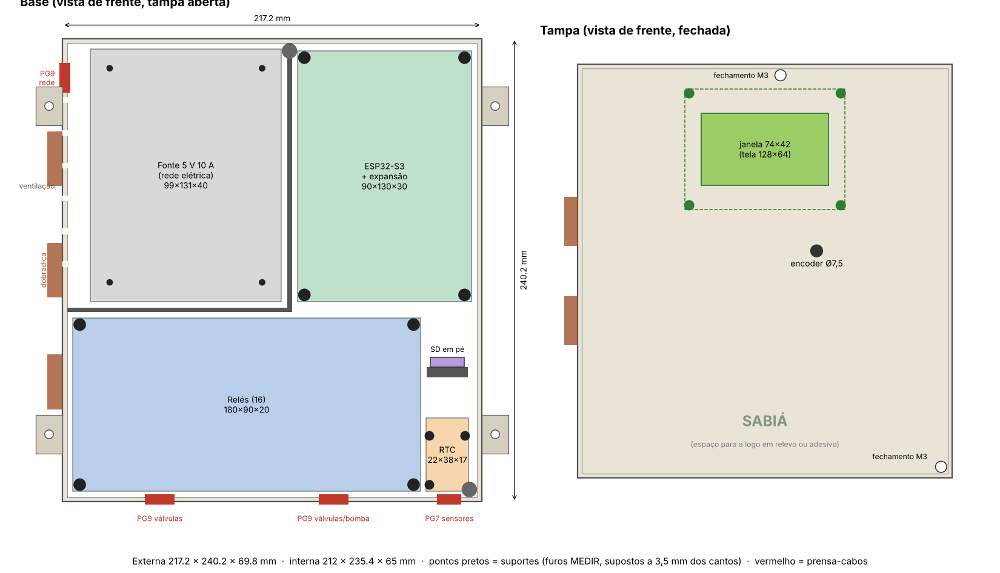
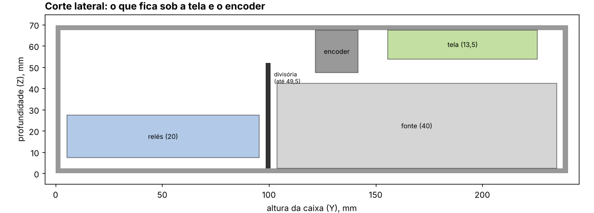
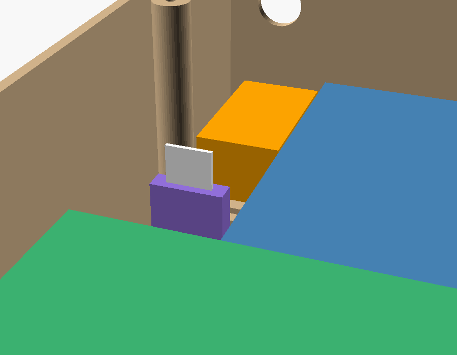

# Caixa do controlador (Rev A)

Caixa de parede impressa em 3D, com uma base que leva os módulos e uma tampa com dobradiça que leva a tela e o encoder. O projeto é paramétrico, em OpenSCAD: [`hardware/caixa-3d/caixa.scad`](../hardware/caixa-3d/caixa.scad). Toda medida está no topo do arquivo e pode ser trocada numa linha.

Para ver por dentro no OpenSCAD, escolha `parte` (no topo do arquivo ou em **Window → Customizer**) e aperte **F5**:
- `por_dentro`: base e componentes, sem tampa;
- `montagem`: caixa fechada, com base e tampa transparentes;
- `aberta`: tampa aberta na dobradiça, com a tela.

A prévia (F5) mostra cores e transparência. A renderização (F6) só serve para exportar o STL, com `parte` em `base` ou `tampa`.

## Medidas

| | Medida |
| --- | --- |
| Externa (fechada) | **217,2 × 240,2 × 69,8 mm** |
| Interna | 212,4 × 235,4 × 65 mm |
| Paredes, fundo e tampa | 2,4 mm |
| Área de impressão da base | 246 × 241 mm (com as abas de parede) |
| Área de impressão da tampa | 226 × 241 mm (com a dobradiça) |

> **Impressora:** a base precisa de uma mesa de pelo menos **250 × 250 mm** (por exemplo, as Bambu Lab de 256 × 256 mm ou a Ender-3 V3 Plus, de 300 × 300 mm). Numa mesa de 220 × 220 mm ela não cabe, e aí é preciso dividir a base em duas partes.

## Leiaute

- **Embaixo:** o módulo de 16 relés, com os cabos das válvulas e da bomba saindo pelo fundo da caixa (dois prensa-cabos PG9). Ao lado ficam o RTC (deitado) e o módulo microSD (em pé), e abaixo deles o PG7 dos sensores.
- **No alto, à esquerda:** a fonte, num **compartimento isolado** por divisórias, porque é a única parte com 127/220 V. A rede entra pela parede esquerda (PG9), com 12 mm livres para a porca, e as fendas de ventilação ficam na mesma parede. Os fios de 5 V saem por uma passagem junto ao fundo.
- **No alto, à direita:** a placa de expansão com o ESP32-S3.
- **Tampa:** a tela centralizada no alto, atrás de um visor de acrílico, e o encoder abaixo e à direita. A dobradiça fica do lado esquerdo e há dois parafusos M3 de fechamento: um na parede direita, no vão entre o RTC e o microSD, e outro no alto da divisória.

As divisórias têm 49,5 mm de altura: ficam acima da fonte (40 mm) e abaixo da tela (13,5 mm de profundidade), por isso a tela pode ficar centralizada.

## Editar no Fusion

O script `hardware/caixa-3d/fusion/SabiaCaixa` desenha a mesma caixa no Fusion, como um projeto nativo: cada parte vira um esboço e uma extrusão com nome na linha do tempo.

**Rodar (uma vez):**

1. Baixe a pasta `SabiaCaixa` inteira (com os dois arquivos, `.py` e `.manifest`).
2. No Fusion: **Utilitários → Suplementos → Scripts e suplementos** (ou `Shift+S`).
3. Clique em **+** → **Script ou suplemento do dispositivo** e escolha a pasta `SabiaCaixa`.
4. Selecione **SabiaCaixa** na lista e clique em **Executar**. Em alguns segundos abre um projeto novo com a caixa.

**O que aparece:**

- Componente **Base**: caixa, divisórias da fonte, suportes, paredinha do microSD, abas de parede, dobradiça e todos os furos.
- Componente **Tampa**: placa, aba de encaixe, janela e suportes da tela, encoder, dobradiça e furos de fechamento.
- Componente **Componentes (só para conferir)**: blocos do tamanho de cada módulo. O bloco da tela fica dentro da Tampa, para abrir com ela. Nenhum deles vai para a impressão.
- Para ver por dentro, esconda a Tampa no navegador (o ícone de olho, à esquerda).
- **A tampa abre de verdade:** ela está ligada à base por uma junta de rotação na dobradiça ("Dobradica", na linha do tempo). Arraste a tampa com o mouse para abrir, até 110 graus. A Base e os componentes ficam fixos. A tela vai junto com a tampa.

**Fazer a junta à mão** (num projeto de antes desta versão, ou se o script avisar que não conseguiu):

1. No navegador, botão direito em **Base** → **Fixar**. Faça o mesmo com **Componentes**.
2. **MONTAR → Junta conforme construída** (`Shift+J`), já que a tampa está no lugar certo.
3. Clique na **Tampa** e depois na **Base**.
4. Em **Tipo**, escolha **Rotação**.
5. Em **Posição**, clique na borda circular do furo do pino de um dos nós da dobradiça. O eixo de rotação passa a ser o do pino.
6. **OK**. Para limitar a abertura: botão direito na junta → **Editar limites da junta**, e marque mínimo e máximo, por exemplo de 0 a 110 graus (ou de -110 a 0, conforme o lado em que ela abre).

**Editar:**

- **Mudar uma altura ou profundidade:** clique duas vezes na extrusão na linha do tempo e troque o número.
- **Mover um furo ou um suporte:** clique duas vezes no esboço dele (por exemplo, "Suportes ESP") e arraste ou ponha uma cota.
- **Muitas medidas de uma vez** (como os furos reais das placas): mude no começo do `SabiaCaixa.py` e rode de novo. Ele cria outro projeto; o anterior não é alterado.

**Diferenças do modelo OpenSCAD:** os furos de fechamento e os da fonte saem retos, sem escareado (dá para fazer com o recurso **Furo** do Fusion), e a janela da tela sai sem o chanfro de fora. A dobradiça é desenhada como um polígono de muitos lados.

**Imprimir:** botão direito no corpo **Base** (e depois na **Tampa**) → **Salvar como malha** → 3MF ou STL. A tampa se imprime com a face de fora na mesa, então vire a peça no fatiador.

O script não foi testado num Fusion de verdade, só num simulado. Se ele parar, a mensagem diz em qual etapa parou: mande um print dela.

## O que medir antes de imprimir

Os itens marcados **MEDIR** no `caixa.scad` são estimativas. Com um paquímetro, confira:

| Parâmetro | O que medir | Valor atual |
| --- | --- | --- |
| `furos_rele` | Centro de cada furo da placa de relés, a partir do canto inferior esquerdo (com a placa na posição da caixa) | 4 cantos, a 3,5 mm das bordas |
| `furos_expan` | O mesmo, na placa de expansão do ESP | 4 cantos, a 3,5 mm |
| `furos_fonte` | Furos roscados no fundo da fonte | 4 cantos, a 10 mm |
| `furos_rtc` | Centro dos 3 furos do RTC (HW-084) e o diâmetro deles | estimado por foto |
| `sd_furo_borda` | Do centro dos 2 furos do microSD até a borda da placa do lado dos pinos | 6 mm |
| `lcd_moldura` | Da frente da moldura da tela até a frente da placa verde | 8,9 mm |
| `d_encoder` | Diâmetro do eixo roscado do encoder | 7,5 mm (EC11, rosca M7) |

O **RTC** fica deitado sobre 3 suportes, com a pilha virada para a frente, para dar para trocar. O **microSD** (18,5 × 17,5 mm, furos a 14 mm) fica em pé, parafusado numa paredinha: o cartão aponta para a tampa e sai puxando para fora, e os pinos apontam para o ESP.

Depois de trocar as medidas, rode `python3 tools/leiaute_caixa.py` para atualizar o desenho do leiaute. Esse script repete os parâmetros do `.scad`, então mude nos dois.

## Material de montagem

| Item | Qtd. | Uso |
| --- | --- | --- |
| Parafuso M3 × 8 autoatarraxante | 8 | Relés e placa de expansão nos suportes |
| Parafuso M3 × 6 | 4 | Fonte, por baixo do fundo |
| Parafuso M3 × 14 cabeça chata | 2 | Fechamento da tampa |
| Parafuso M2.5 × 8 autoatarraxante | 9 | Tela (4), RTC (3) e microSD (2) |
| Vareta de 3 mm × 145 mm (ou arame/parafuso M3 longo) | 1 | Pino da dobradiça |
| Prensa-cabos PG9 | 3 | Válvulas, bomba e rede elétrica |
| Prensa-cabos PG7 | 1 | Sensores |
| Acrílico transparente 1 mm, 79,5 × 47,5 mm | 1 | Visor da tela |
| Parafuso 4 mm + bucha 6 | 4 | Fixação na parede |

## Impressão

- **Material:** PETG ou ASA. O PLA amolece ao sol.
- **Base:** imprima de costas na mesa, com a abertura para cima. A dobradiça tem uma rampa e imprime sem suporte.
- **Tampa:** já sai virada no STL, com a face externa na mesa, o que deixa a janela e o acabamento da frente lisos.
- 4 perímetros e preenchimento de 20 a 25%. Os suportes e ressaltos ficam sólidos com 4 perímetros.
- Os furos para autoatarraxante são de 2,6 mm (M3) e 2,2 mm (M2.5), calibrados para PETG. Se o parafuso apertar demais ou ficar frouxo, ajuste `d_auto_m3` e `d_auto_m25`.

**Arquivos STL:** o GitHub Actions gera `sabia-caixa-base.stl` e `sabia-caixa-tampa.stl` a cada mudança no `.scad`. Para baixar, abra a aba **Actions**, entre na última execução de **Caixa 3D** e baixe o artefato **caixa-3d**. O workflow falha se o OpenSCAD emitir qualquer aviso ou se o sólido sair inválido.

## Cuidados

- **Rede elétrica:** a fonte fica isolada, mas os bornes dela devem ter tampa, e o fio terra vai ligado na fonte. O fusível de 3 A fica na saída de 5 V, dentro do compartimento da fonte.
- **Chuva:** a aba da tampa encaixa por dentro das paredes e os cabos entram por baixo, com a curva de pingar. As fendas de ventilação ficam na lateral: instale a caixa sob uma cobertura ou beiral. Se precisar de mais vedação, dá para imprimir uma junta de TPU para a aba da tampa.
- **Calor:** a fonte de 10 A dissipa alguns watts. Se a caixa ficar ao sol, prefira ASA na cor branca ou clara.
